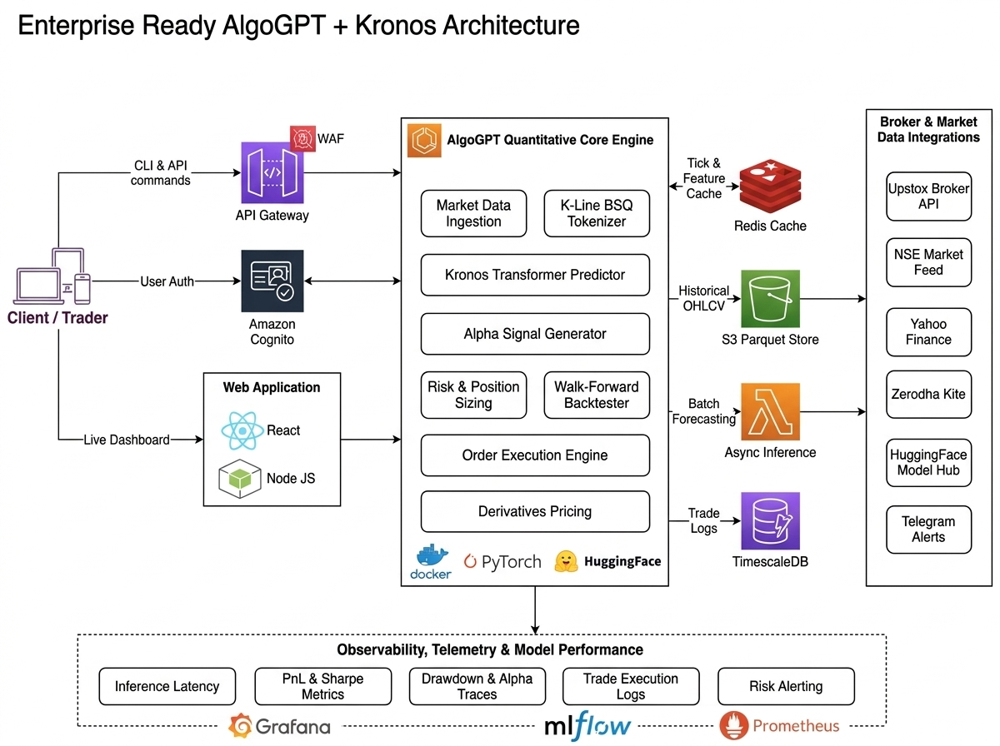

<div align="center">
  
</div>

# AlgoGPT + Kronos: Open-Source AI Foundation Model for Indian Derivatives and Equity Market Data

[](https://www.python.org/downloads/)
[](https://pytorch.org/)
[](https://huggingface.co/NeoQuasar/Kronos-small)
[](https://pandas.pydata.org/)
[](https://scikit-learn.org/)
[](https://matplotlib.org/)
[](LICENSE)

A clean, modular codebase for finetuning the Kronos foundation model on NIFTY/BANKNIFTY data and running systematic trading strategies.

## Core Algorithm:
 - **[Release v2.0] October, 2026**: Upgraded with **Kronos Foundation Model** (BSQ K-Line Tokenizer + Causal Autoregressive Transformer), multi-symbol walk-forward backtesting, and automated market data feeds (Yahoo Finance, Upstox, NSE).
 - **[Release v1.0] June, 2024**: I release [AlgoGPT-Broker Setup Module](https://github.com/NoobMaster1999/AlgoGPT/blob/main/Broker%20Setup.ipynb)!  🔥[Base Model](https://github.com/NoobMaster1999/AlgoGPT/tree/main/Basic%20Version%20V1.0), [Core Structure](https://arxiv.org/abs/2306.06031)!

## Model Performance:
 - **[Version 2.0] October, 2026**: **Kronos Foundation Engine** (`NeoQuasar/Kronos-small` & `Kronos-Tokenizer-base`) with continuous BSQ candlestick tokenization, multi-step autoregressive price path generation, and systematic options derivative backtesting with risk metrics (Sharpe Ratio, Alpha, Max Drawdown).
 - **[Version 1.0] April, 2024**: [Base Model](https://github.com/NoobMaster1999/AlgoGPT/blob/main/Assests/Screenshot%202024-07-02%20171707.png) Model Accuracy: 0.43

## Architecture

<div align="center">
  
</div>

```
algogpt/
├── model/           # Kronos foundation model (tokenizer, model, predictor)
├── data/            # Data fetching & dataset creation for Indian derivatives
├── training/        # Finetuning pipelines (tokenizer + predictor)
├── trading/         # Feature engineering, signals, backtesting
├── main.py          # Main trading pipeline entry point
├── quickstart.py    # Quick test with Yahoo Finance
└── requirements.txt # Dependencies
```

## Quick Start

```bash
# Install dependencies
pip install -r requirements.txt

# Run quick test (uses Yahoo Finance for NIFTY daily data)
python quickstart.py
```

## Forecast dashboard and GitHub Pages

The [dashboard](../docs/index.html) displays published NIFTY 50, BANKNIFTY and FINNIFTY forecasts. Open a saved forecast to review the original range and its observed outcome. The scorecard compares the model's horizon-close error with carrying the last known close forward. Coverage measures how often the observed final close landed inside each published interval. The number of completed forecasts matters when interpreting either measure.

From the **workspace root** (the folder containing `docs` and `run_update.py`), run:

```bash
python -m http.server 8080 --bind 127.0.0.1 --directory docs
```

Open [the local dashboard](http://127.0.0.1:8080/). The browser reads the last successful publication. Each scheduled update fetches market data, runs Kronos, archives forecasts and reconciles outcomes. The checked-in historical data lets the dashboard work before the first successful update.

### Publish from GitHub

1. Add the workspace's `.github/workflows/dashboard.yml`, `docs/`, `algogpt/`, `scripts/`, and `run_update.py` to the same repository, preserving their layout. Include `tests/` to run the regression suite locally.
2. In **Settings → Pages → Build and deployment**, choose **GitHub Actions**. Enable Actions and allow the workflow's token to write generated data to the default branch. Protected branches may require a repository-specific publishing arrangement.
3. On the default branch, open **Actions → Forecast dashboard → Run workflow**. Clear the refresh checkbox to deploy the saved dashboard immediately. Select it to generate and publish a new forecast. The deploy job reports the Pages URL.
4. The workflow requests hourly refreshes from **09:47 through 14:47 India time** and a closing refresh at **16:47**, Monday through Friday. Queuing, exchange holidays and data-provider availability affect when new forecasts appear. Inspect a failed run under Actions. A failed generation, validation or archive push stops that deployment.

### Run a refresh locally

```bash
python -m pip install torch --index-url https://download.pytorch.org/whl/cpu
python -m pip install -r algogpt/requirements-dashboard.txt
python run_update.py
python scripts/check_dashboard.py
```

The first forecast run downloads the model and tokenizer from Hugging Face and requests market history from Yahoo Finance. Keep the contents of `docs/data` between updates. Archive links and scorecard history depend on those files. The initial nine forecasts issued on 23 November 2026 may include imputed volume in their historical data. Later snapshots mark unavailable reported volume separately from the model's volume input. The dashboard and scorecard display price outcomes.

### Four-week research pilot

Ask five first-time users to identify the issue time, target session and predicted range without assistance. Record which step caused confusion. Then invite 10–15 researchers to review forecasts over four weeks. The optional Research pilot control stores visit and completed-review days on each participant's browser. Participants can export weekly totals or erase their counts. For a cohort review, collect one latest export per consenting participant and sum the returning-reviewer column by week. A returning reviewer opened a completed forecast on a later India-calendar day than their first visit on that device. Look for five returning participants in each of two consecutive weeks, and ask them what brought them back. Treat this as a pilot decision threshold.

## Data Sources

| Source | Description | Setup |
|--------|-------------|-------|
| `csv` | Local CSV files in `./data/` | Place `{SYMBOL}_5min.csv` files |
| `yahoo` | Yahoo Finance (free, daily/intraday) | No setup needed |
| `upstox` | Upstox API (live + historical) | Requires API credentials |
| `nse` | NSE via nsepython (daily only) | `pip install nsepython` |

### CSV Format
Place files in `./data/` with columns: `timestamp, open, high, low, close, volume`
```csv
timestamp,open,high,low,close,volume
2024-01-01 09:15:00,21000,21050,20980,21020,1500000
```

## Finetuning on Indian Derivatives

### 1. Prepare Data
```bash
# Download NIFTY/BANKNIFTY 5min data to ./data/
# Or use Upstox API with credentials
```

### 2. Configure Training
Edit `training/config.py` or use environment variables:
```bash
export SYMBOLS="NIFTY,BANKNIFTY"
export DATA_SOURCE="csv"
export DATA_DIR="./data"
export INTERVAL="5min"
export START_DATE="2020-01-01"
export END_DATE="2024-12-31"
export PREDICTOR_EPOCHS=30
export BATCH_SIZE=50
```

### 3. Run Distributed Finetuning
```bash
# Tokenizer finetuning (run first)
torchrun --standalone --nproc_per_node=1 training/train_tokenizer.py

# Predictor finetuning (uses finetuned tokenizer)
torchrun --standalone --nproc_per_node=1 training/train_predictor.py
```

For multi-GPU:
```bash
torchrun --standalone --nproc_per_node=4 training/train_predictor.py
```

### 4. Use Finetuned Models
```python
from algogpt.model import KronosPredictor

predictor = KronosPredictor.from_local(
    model_path="./outputs/models/finetune_predictor_indian/checkpoints/best_model",
    tokenizer_path="./outputs/models/finetune_tokenizer_indian/checkpoints/best_model",
)
```

## Trading Pipeline

```bash
# Basic backtest on NIFTY
python main.py --symbol NIFTY --start 2023-01-01 --end 2024-06-01

# With Upstox data
python main.py --symbol BANKNIFTY --data-source upstox \
  --upstox-api-key YOUR_KEY --upstox-api-secret YOUR_SECRET \
  --upstox-access-token YOUR_TOKEN

# Using finetuned model
python main.py --model ./outputs/models/finetune_predictor_indian/checkpoints/best_model \
  --tokenizer ./outputs/models/finetune_tokenizer_indian/checkpoints/best_model
```

## Key Components

### Model (`algogpt/model/`)
- **KronosTokenizer**: Hybrid quantization (BSQ) encoder-decoder
- **Kronos**: Autoregressive transformer with hierarchical tokens (s1+s2)
- **KronosPredictor**: High-level inference with normalization, sampling, batch prediction

### Data (`algogpt/data/`)
- **DataFetcher**: Abstract base + Upstox/NSE/Yahoo/CSV implementations
- **IndianDerivativesDataset**: Sliding window dataset with proper normalization
- **create_train_val_datasets**: Time-aware train/val split (no lookahead bias)

### Training (`algogpt/training/`)
- **FinetuneConfig**: Centralized dataclass config with env overrides
- **train_tokenizer.py**: DDP tokenizer finetuning (BSQ loss)
- **train_predictor.py**: DDP predictor finetuning (next-token CE loss)
- **utils.py**: DDP setup, seeding, checkpointing, Comet logging

### Trading (`algogpt/trading/`)
- **FeatureEngineer**: 30+ technical indicators (RSI, MACD, BB, candles, etc.)
- **SignalGenerator**: Kronos + TA weighted ensemble with MACD filter
- **KronosBacktester**: Walk-forward with realistic execution (next-bar open, slippage, commission)

## Indian Derivatives Specifics

| Symbol | Lot Size | Expiry | Tick Size |
|--------|----------|--------|-----------|
| NIFTY | 50 | Thursday | 0.05 |
| BANKNIFTY | 15 | Wednesday | 0.05 |
| FINNIFTY | 40 | Tuesday | 0.05 |
| MIDCPNIFTY | 75 | Monday | 0.05 |

Time features: minute, hour, weekday, day, month (IST timezone)

## Configuration

All configs use Python dataclasses with:
- Type hints and defaults
- Environment variable overrides (`export PARAM=value`)
- Validation in `__post_init__`
- Dict-like access for backward compatibility

## Requirements

- Python 3.10+
- PyTorch 2.0+ (CUDA recommended)
- 8GB+ VRAM for finetuning (batch_size=50)
- 16GB+ RAM for data processing

## License

MIT License - See LICENSE file for details.
